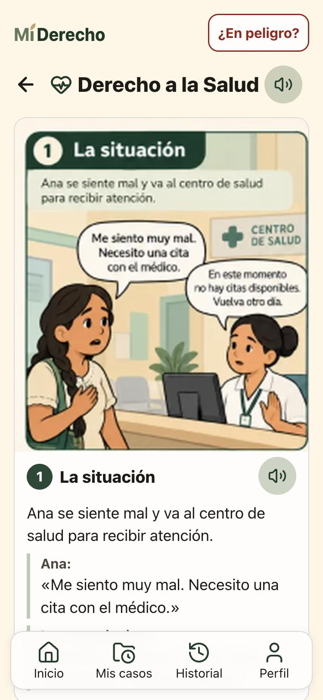
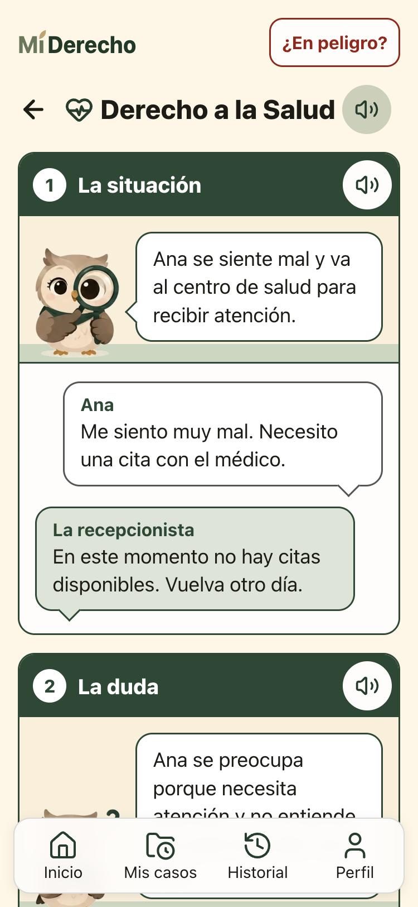

# Revisión de calidad de la app (21-oct-2026)

Rama `claude/revision-calidad-00c357`, sobre main `f1289de`. Se revisó producción (https://miderecho-two.vercel.app) y la app local (`apps/web`) en celular (375 px) y en escritorio, pantalla por pantalla. No hay errores en la consola, ninguna pantalla tiene scroll horizontal y todos los botones miden 44 px o más (los únicos más pequeños son enlaces dentro del texto, como «llame al 123», y al lado siempre hay un botón grande).

## 1. Lo que Juan vio: las historietas de los derechos

**El problema.** Cada tema de «Conozca sus derechos» (salud, trabajo, vivienda, petición, igualdad y otros) tenía 4 cuadros en `public/figma/comic-*.webp`, 24 imágenes en total. Venían de una captura del Figma de 374 × 464 px que traía los 4 cuadros juntos, o sea unos 185 px por cuadro, y se ampliaron al doble. Por eso:

- se veían borrosos, sobre todo en celulares con pantalla de alta resolución;
- el texto dibujado dentro de los globos y de las listas no se podía leer;
- el mismo texto se repetía debajo de cada imagen, así que cada cuadro se leía dos veces;
- pesaban 450 KB que el celular guarda para usar la app sin internet.

En el repositorio no había una versión más grande: la primera versión (`79018d0`) ya traía la captura a 1x.

**Lo que se hizo** (`apps/web/src/pantallas/Derecho.jsx` y el bloque «Historieta» de `estilos.css`):

- Cada cuadro ahora es una viñeta con texto real. Es nítida en cualquier pantalla, se puede leer en voz alta y casi no pesa.
- La barra verde lleva el número, el título y el botón para escuchar, igual que en la historieta de la política.
- **El búho** cuenta la escena en un globo, y su pose cambia según el momento de la historia: lupa en «La situación», pensando en «La duda», ley en «Lo que aprende» y documento en «Qué puede hacer».
- Los personajes hablan en globos con su nombre. La protagonista habla a la derecha en globo blanco y los demás a la izquierda en globo verde. Lo que alguien piensa va en un globo de borde punteado con burbujas.
- Las listas («Le pueden indicar») y los pasos numerados van en una tarjeta punteada.
- Se borraron los 24 WebP. El caché sin internet pasa de 450 KB a 31 KB en imágenes de historietas (las 4 poses del búho).
- No se tocó el contenido: los textos son los mismos de `packages/nucleo/src/derechos.js` (`cuadros`).

| Antes (igual que en producción) | Después |
|---|---|
|  |  |

Más capturas:

- [cuadros 2 y 3](capturas/despues-derecho-salud-cuadros-2-3.jpg): pensamiento y lista;
- [cuadro 4](capturas/despues-derecho-salud-cuadro-4.jpg): los pasos;
- [vivienda en escritorio](capturas/despues-derecho-vivienda-escritorio.jpg);
- [trabajo en producción, antes](capturas/antes-produccion-trabajo-movil.jpg);
- [comparación lado a lado](capturas/antes-despues-historieta.jpg).

Si Valentina exporta los dibujos del Figma a 2x o más, cada uno puede volver como fondo de la escena de su viñeta, sin texto dibujado. Están en el historial de git (`git show f1289de:apps/web/public/figma/comic-salud-1.webp`).

## 2. La política de datos en historieta (`#/politica`)

**La sesión buho-app ya la está cambiando** (rama `claude/buho-app-4c00bc`, todavía sin commit): pone al búho en lugar del globo con cara que hacía de asistente, con una pose distinta en cada viñeta, y lo agrega en «Política completa». Para no pisar ese trabajo, aquí **no se tocó** `Politica.jsx` ni `politica.css`.

Revisión de la versión actual ([captura](capturas/antes-politica-movil.jpg)):

- Los globos son de texto real: legibles, cortos y en «usted». Las viñetas y la barra de avance se ven limpias.
- El contenido jurídico está completo: Ley 1581 de 2012, Decreto 1377 de 2013 y «MiDerecho S.A.S.» como responsable, con el celular 316 807 7161.
- Doña Rosa, la campesina, está bien como personaje humano: el búho le explica a ella.
- **Arreglado aquí** (`App.jsx`, una línea): mientras se descargaba la pantalla, la app quedaba en blanco. En una conexión rural lenta parecía dañada. Ahora dice «Cargando la política de datos…».
- **Para buho-app:** `identidad/buho/pensando.webp` (y el `.png`) tiene un pedazo suelto de otra pose en el borde derecho. La copia de buho-app en `public/buho/` ya viene recortada; convendría reemplazar también la de `identidad/` para la presentación y el video.

## 3. Otras mejoras aplicadas (claras y de bajo riesgo)

| Dónde | Problema | Cambio |
|---|---|---|
| Documento, paso 2 ([antes](capturas/antes-peticion-paso2-movil.jpg), [después](capturas/despues-peticion-paso2-movil.jpg)) | «Municipio» y «Vereda» iban lado a lado y en 375 px el texto de ayuda se cortaba («Escriba o escoj…») | `.fila-2` pone un campo debajo del otro cuando no caben (`auto-fit`, una regla de CSS). También aplica a Día y Hora en los avisos. |
| ¿En peligro?, Perfil y Asistente ([antes](capturas/antes-peligro-movil.jpg), [después](capturas/despues-peligro-movil.jpg)) | El correo de Somos Defensores se partía con una «g» sola en la última línea | `<wbr>` después de la «@» en `AYUDA_RIESGO` (`packages/nucleo/src/contenido.js`) |
| Aviso antes de usar el asistente (`Consentimiento.jsx`) | El enlace llevaba a la política en texto legal | Ahora lleva a la **historieta**, que es la versión en lenguaje claro. Desde ahí se puede ver la completa, y «Salir» devuelve al aviso. |
| `README.md`, `derechos.js`, `vite.config.js` | Comentarios que hablaban de los cuadros del Figma | Actualizados |
| Crear un documento ([antes](capturas/antes-peticion-temas-movil.jpg), [después](capturas/despues-peticion-temas-movil.jpg), [servicios](capturas/despues-servicios-movil.jpg)) | Las opciones (temas de la petición, servicio y motivo del reclamo, qué niega la EPS, derechos de la tutela) usaban emojis, mientras el resto de la app usa íconos de línea. En Android viejos algunos emojis salen como cuadritos | En `Opciones` (`Documento.jsx`), un mapa emoji → ícono Lucide (💧 gota, 🏥 hospital, ⚖️ balanza, ✂️ tijeras…). Son verdes y se vuelven blancos al seleccionar. Si el núcleo trae un emoji nuevo que no está en el mapa, se muestra el emoji. No se tocó el núcleo, porque la API también usa esas listas. |

## 4. Propuestas (no implementadas: más grandes o dudosas)

1. **Emojis en Mis casos.** «Crear un documento» ya usa íconos (sección 3), pero en Mis casos siguen los emojis: el tipo de cada caso (📄 ⚖️ 🏥 …, guardado en el celular), el estado (✅ ⚠️ ⏳ ⛔) y «A mi favor / En contra» (🎉 ✋). Se puede reusar el mismo mapa. No se hizo porque `MisCasos.jsx` lo cambia buho-app y no estaba en el pedido.
2. **«Su documento está listo».** El documento queda plegado al final, debajo de la clave («Ver el documento»). Proponemos mostrar una vista previa corta arriba o dejarlo abierto, para que la persona vea su papel antes de guardarlo.
3. **Aviso antes de usar el asistente.** Son 5 puntos y unas 120 palabras seguidas.
   - Propuesta: el búho (pose `computador`) con 3 frases cortas, y lo demás plegado en «Ver más».
   - No se hizo porque es un texto legal que se pide por versión (`CONSENTIMIENTO = 2`): cambiarlo obliga a subir la versión y a revisarlo con la política.
4. **Diálogos en «tú».** En las historietas de derechos, los personajes se tratan de «tú», como en el Figma, y la app le habla a la persona de «usted». Funciona porque son personajes hablando entre ellos, pero si se quiere todo en «usted», hay que cambiar `derechos.js` y avisarle a Valentina.
5. **Usar `Buho.jsx` en las viñetas.** Cuando se una la rama de buho-app, `Derecho.jsx` puede cambiar su `` por `<Buho pose=… />`. Así ganaría la entrada suave del búho y el tamaño quedaría en un solo lugar. Hoy no se puede porque ese componente todavía no existe en main.

## 5. Coordinación con buho-app

buho-app ya está en main (`20f2a6a` y `385c4fa`), y main se unió a esta rama sin conflictos (`5813f64`). Después de la unión, `npm test` y el build pasan. Las historietas y «Crear un documento» se ven bien junto al búho de buho-app. `Politica.jsx` y las imágenes de `public/buho/` quedan exactamente como en main: esta rama no las cambia.

## 6. Verificación

- `npm test` (raíz): todo pasa (núcleo, api, correo, avisos, llamadas, almacén y avisos web).
- `npm run build -w apps/web`: pasa; después de unir main, el precache queda en 23 archivos, 606 KB (incluye las 11 poses del búho).
- En el navegador integrado, con la app local en 375 px y en escritorio, se revisaron los 6 temas de derechos, el formulario del derecho de petición hasta «Su documento está listo», «¿En peligro?» y el aviso de la IA con su enlace a la historieta. También se vio el mensaje de carga de la política. La consola quedó sin errores.
- Para correr la app local con `preview_start` se agregó la configuración `web` (puerto 5181) en `.claude/launch.json`. Ese archivo está en `.gitignore`, así que no va en el commit.
